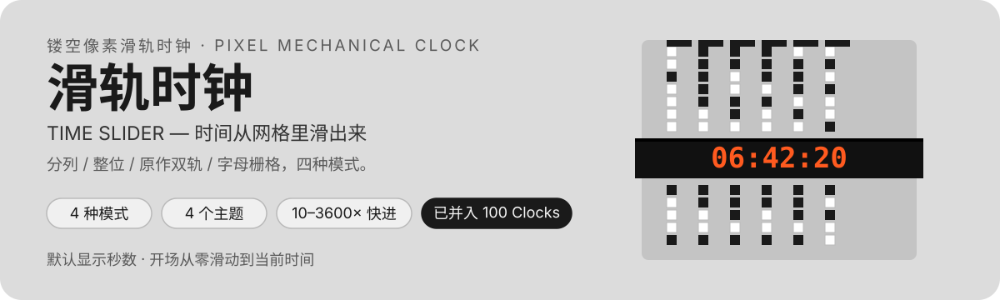
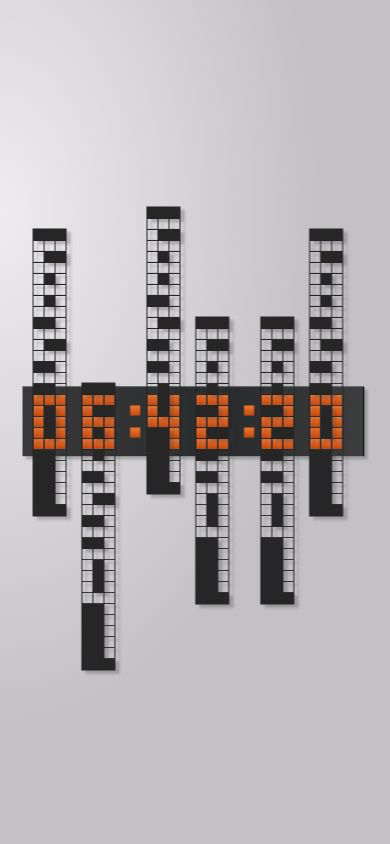

<p align="right"><a href="README.md">中文</a></p>

> **Merged into [100 Clocks](https://github.com/holynova/100-clocks).** The clock itself is now maintained at [100 Clocks](https://100-clocks.xiaosang.cc/?clock=slider-column); this repo keeps the historical source, references and tests, and old URLs redirect to the matching clock.

<p align="center">
  
</p>

<p align="center">
  <a href="https://100-clocks.xiaosang.cc/?clock=slider-column">▶ Try Online</a>
  ·
  <a href="https://github.com/holynova/time-slider-clock">GitHub Repository</a>
</p>

Time Slider is a pixel mechanical clock: six perforated rails slide up and down, and the time emerges from the overlapping 5×5 grids. Four modes — column, whole-digit, original dual-rail and 5×5 alphabet — with seconds shown by default and a zero-to-current-time opening animation on load. Pure static pages, zero dependencies.

## Screenshots

<p align="center">
  
  
</p>

## Modes

| Mode | Description | Try Online |
| :--- | :--- | :--- |
| 分列滑轨 Column | One independent rail per digit | [100 Clocks · slider-column](https://100-clocks.xiaosang.cc/?clock=slider-column) |
| 整位滑轨 Whole-digit | Three rails sharing one 0–9 mask, sliding as whole digits | [100 Clocks · slider-whole](https://100-clocks.xiaosang.cc/?clock=slider-whole) |
| 原作双轨 Original dual-rail | Faithful to Hans Andersson's two masks and offsets — one column on the left, two on the right, sliding independently | [100 Clocks · slider-dual](https://100-clocks.xiaosang.cc/?clock=slider-dual) |
| 字母栅格 Alphabet | The same continuous perforated rails, supporting A–Z, digits and 16 symbols; type up to six characters in the input box below to transition smoothly | [100 Clocks · alphabet](https://100-clocks.xiaosang.cc/?clock=alphabet) |

## Features

- **4 themes**: classic grey wall, fluorescent green, fluorescent yellow, OLED black; follows the system theme and remembers your choice.
- **Clock-only mode and fullscreen**: hides the controls, leaving only the rails and the time.
- **Accelerated testing**: 10 / 60 / 600 / 3600× speed-up, with a settable start time, pause and resume.
- **Alphabet carousel**: alphabet mode opens with a one-word-per-second carousel covering the full character set; pausable from the menu, and clicking the input box stops it for editing.

## Run Locally

Zero build — just serve the static files (historical source in `dist/`):

```bash
python3 -m http.server 4178 --directory dist
# Open http://localhost:4178/whole-digit/
```

Checks (6 sets of .cjs tests + JS syntax checks on 4 pages + redirect-mapping tests):

```bash
npm run check
```

## Tech

- Pure HTML + CSS + JS, zero dependencies; each mode is a self-contained HTML file (`dist/`).
- Tests cover all 86,400 HH:MM:SS readings, midnight rollover, pause/resume and reduced motion; the alphabet version validates 53 distinct 5×5 glyphs.
- The lattice design references [Hans Andersson's Time Slider](https://tiltedtwister.com/timeslider.html); the dual-rail version reuses his two masks and fixed shell, with derived geometry under [CC BY-NC-SA 4.0](https://creativecommons.org/licenses/by-nc-sa/4.0/); the six-digit seconds, web animation and alphabet grid are this project's own extensions.

```
dist/index.html         Column mode
dist/whole-digit/       Whole-digit mode
dist/hardware/          Original dual-rail (with ATTRIBUTION.txt)
dist/matrix/            Alphabet grid
tests/                  clock / whole-digit / startup / new-modes / letter-*
references/             Alphabet rail optimization plans and candidate glyphs
worker.js               Old paths 308-redirect to 100 Clocks
```
