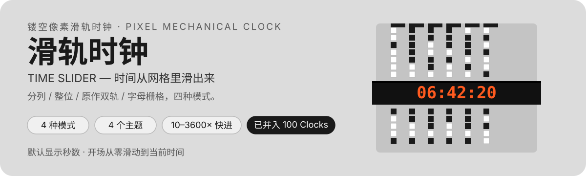
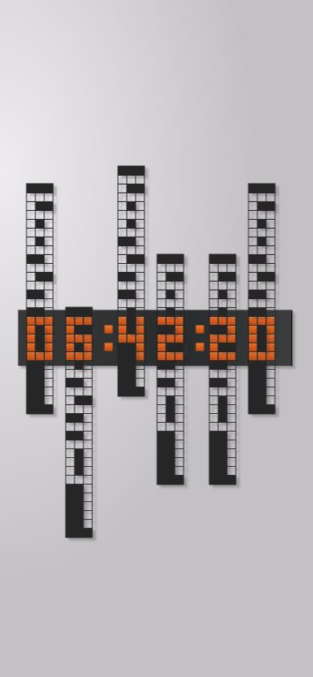

<p align="right"><a href="README.en.md">English</a></p>

> **已合并到 [100 Clocks 时间实验室](https://github.com/holynova/100-clocks)。** 时钟本体现在 [100 Clocks](https://100-clocks.xiaosang.cc/?clock=slider-column) 维护；本仓库保留历史源码、参考与测试，旧线上路径自动跳转到对应版本。

<p align="center">
  
</p>

<p align="center">
  <a href="https://100-clocks.xiaosang.cc/?clock=slider-column">▶ 在线体验</a>
  ·
  <a href="https://github.com/holynova/time-slider-clock">GitHub 仓库</a>
</p>

滑轨时钟用上下滑动的镂空网格显示时间：六条刻有 5×5 镂空图案的滑轨上下移动，数字从网格交错中浮现。提供分列、整位、原作双轨与字母栅格四种模式，默认显示秒数，进入或刷新时从零滑动到当前时间。纯静态页面，零依赖。

## 截图

<p align="center">
  
  
</p>

## 模式

| 模式 | 说明 | 在线体验 |
| :--- | :--- | :--- |
| 分列滑轨 | 每位数字一条独立滑轨 | [100 Clocks · slider-column](https://100-clocks.xiaosang.cc/?clock=slider-column) |
| 整位滑轨 | 三条滑轨共用 0–9 遮罩，整位滑动 | [100 Clocks · slider-whole](https://100-clocks.xiaosang.cc/?clock=slider-whole) |
| 原作双轨 | 复用 Hans Andersson 原作的两片遮罩与位置表，左一列、右两列独立滑动 | [100 Clocks · slider-dual](https://100-clocks.xiaosang.cc/?clock=slider-dual) |
| 字母栅格 | 相同的连续镂空滑轨，支持 A–Z、数字及 16 种符号；下方输入框可输入六个字符，平滑过渡 | [100 Clocks · alphabet](https://100-clocks.xiaosang.cc/?clock=alphabet) |

## 功能

- **4 个主题**：经典灰墙、荧光绿、荧光黄、纯黑荧光；支持跟随系统并记住选择。
- **仅时钟模式与全屏**：隐藏控制，只留滑轨与时间。
- **快进测试**：10 / 60 / 600 / 3600 倍加速，可指定起始时间、暂停与继续。
- **字母轮播**：字母模式默认开启每秒一词的轮播，完整覆盖字符集；菜单可暂停，点击输入框可停止并编辑。

## 本地运行

零构建，直接起静态服务器（历史源码在 `dist/`）：

```bash
python3 -m http.server 4178 --directory dist
# 打开 http://localhost:4178/whole-digit/
```

检查（6 组 .cjs 测试 + 4 个页面的 JS 语法检查 + 跳转映射测试）：

```bash
npm run check
```

## 技术

- 纯 HTML + CSS + JS，零依赖；每种模式一个自包含的 HTML 文件（`dist/`）。
- 测试覆盖全部 86,400 种 HH:MM:SS 读数、午夜翻转、暂停/继续与减动效；字母版验证 53 个不同的 5×5 字形。
- 网格外观参考 [Hans Andersson 的 Time Slider](https://tiltedtwister.com/timeslider.html)；原作双轨版复用其两片遮罩及固定外壳，衍生几何遵循 [CC BY-NC-SA 4.0](https://creativecommons.org/licenses/by-nc-sa/4.0/)；六位秒钟、网页动画与字母栅格是本项目扩展。

```
dist/index.html         分列滑轨
dist/whole-digit/       整位滑轨
dist/hardware/          原作双轨（含 ATTRIBUTION.txt）
dist/matrix/            字母栅格
tests/                  clock / whole-digit / startup / new-modes / letter-*
references/             字母滑轨优化方案与候选字形
worker.js               旧路径 308 跳转到 100 Clocks
```
